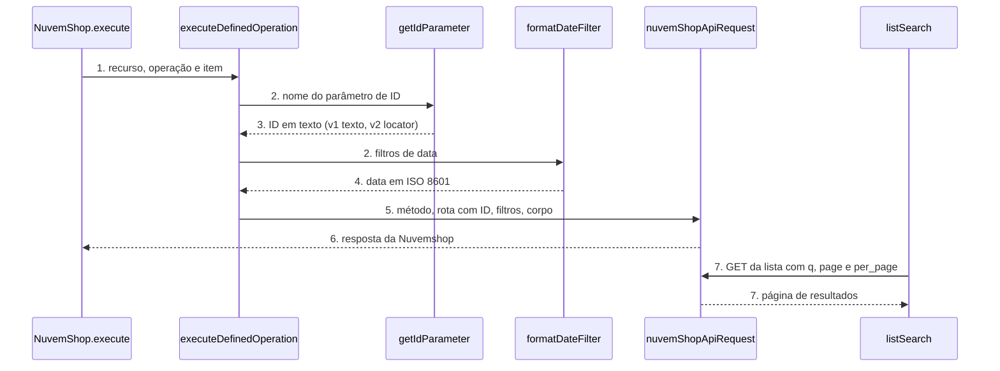

# Nuvem Shop: node-cli 0.55 e campos guiados (versão 2 do node)

**Approved**: pendente

> Build this with **tlc-implement**. Every criterion becomes a check with a proof; nothing under
> the open questions is settled while building.

## Problem

O pacote `n8n-nodes-nuvemshop` 1.1.3 usa o `@n8n/node-cli` 0.38.8. O `n8n-node lint` do 0.55.5, que a guideline de verificação do n8n exige, acusa 1 erro (a categoria `Marketing` em `NuvemShop.node.json` não existe; o valor aceito é `Marketing & Content`) e 1 aviso (um `eslint-disable` sem efeito no trigger). O `n8n-workflow` do `devDependencies` está em `^2.16.0` e o `latest` do npm parou nessa versão. Nenhuma chamada HTTP do pacote passa `timeout`: um servidor da Nuvemshop travado prende a execução.

Em julho o pacote ganhou campos guiados: filtros e corpo viraram `collection`, e os IDs de produto, categoria, pedido, cliente, cupom, local, variante e webhook viraram dropdown (`options` com `loadOptionsMethod`). Esse dropdown carrega só as 200 primeiras linhas de `GET /products`, `/orders` e das demais listas, sem busca e sem aviso de corte. Numa loja com mais de 200 pedidos ou produtos, o item que a pessoa procura não aparece, e ela cola o ID à mão. Os filtros de data (`created_at_min`, `updated_at_max` e os outros 6 de cada lista, mais as 4 datas de cupom) são caixa de texto: a pessoa digita o formato ISO 8601 de cabeça. O `Values` de variante é um campo JSON cru, embora a doc defina a forma `[{"pt": "Tamanho G"}]`. Os outros IDs de caminho (carrinho, checkout, pedido rascunho, transação, disputa, blog, post, página, script, template de e-mail, imagem, metafield, kit, ordem de envio e outros) continuam texto livre.

Quando isso sair: o lint oficial passa sem erro, o node novo mostra nos 5 campos de ID principais uma lista pesquisável e paginada da loja, com a opção de colar o ID, as datas dos filtros viram seletor de data e as variantes têm campos próprios. Workflows salvos continuam iguais, sem nenhuma edição.

## Shape

Reutiliza `nuvemShopApiRequest` (transporte), os rótulos de `toOptions` de `loadOptions.ts` e a tabela de definições de operação; os modos de lista do Resource Locator chamam as mesmas rotas de listagem. A regra que muda o resultado, ler o ID do campo (texto na versão 1, objeto `{ mode, value }` na versão 2), fica numa função única `getIdParameter`, chamada por `resolvePath` e por `loadOptions.getProductVariants`, que os testes alcançam pelo `execute` do node.

1. entra o item do workflow -> `NuvemShop.execute` (exists) - lê `resource` e `operation` e chama `executeDefinedOperation`
2. `executeDefinedOperation` (exists) - monta rota, filtros e corpo da operação
3. `getIdParameter` (new) - na versão 1 devolve o texto do parâmetro; na versão 2 devolve o `value` do Resource Locator, sem espaço nas pontas; nos dois casos devolve texto, ou lança erro se vazio
4. `formatDateFilter` (new) - na versão 2 valida que a data é ISO 8601 e a envia como veio; nas 4 datas de cupom corta para `YYYY-MM-DD`; na versão 1 não toca no texto
5. `nuvemShopApiRequest` (exists) - monta a requisição com `timeout` de 30 s e chama `httpRequestWithAuthentication`
6. out: a resposta da Nuvemshop como itens do n8n, igual à 1.1.3
7. no editor, `listSearch` (new) - recebe o texto de busca e o `paginationToken`, chama a rota de listagem do recurso e devolve `{ results, paginationToken }`

**Changes underneath**

| Front | What changes |
| --- | --- |
| domain | nada: os recursos e as operações não mudam |
| stored data | nothing to migrate: workflows salvos guardam `typeVersion` 1 e continuam lendo texto |
| readers | o editor do n8n mostra a versão 2 só em node novo; `loadOptions.getProductVariants` passa a ler o produto pelo `getIdParameter` |
| toolchain | `package.json`, `NuvemShop.node.json`, o trigger e os dois workflows do GitHub chegam ao padrão do node-cli 0.55.5 |

Data: none - o node não guarda dado; ele repassa a requisição para a Nuvemshop e devolve a resposta.

New: nothing - read only.

## Surface

| Route | In | Out | Status | Who |
| --- | --- | --- | --- | --- |
| node `nuvemShop` versão 2 | os 5 IDs principais como Resource Locator `{ mode, value }` com mode list ou id, datas como `dateTime`, `Values` de variante como `fixedCollection` | a mesma resposta da versão 1 | `200`; `401` com credencial inválida vira `NodeApiError`; demais `4xx` e `5xx` também | quem tem credencial Nuvemshop válida; sem ela a API devolve `401` |
| node `nuvemShop` versão 1 | IDs em dropdown, datas e `Values` em texto, iguais à 1.1.3 | igual à 1.1.3 | `200`; `401` com credencial inválida vira `NodeApiError`; demais `4xx` e `5xx` também | workflows salvos com credencial válida; sem ela a API devolve `401` |
| `listSearch` de produto, categoria, pedido, cliente e cupom | texto de busca e `paginationToken` | `{ results: [{ name, value }], paginationToken? }` | `200`; `401` com credencial inválida vira `NodeApiError` | o editor do n8n com credencial válida; sem ela a API devolve `401` |

## Landing

| One-way door | Literal shape | Alternative rejected |
| --- | --- | --- |
| versão do node | `version: [1, 2]`, `defaultVersion: 2`; campos novos com `displayOptions.show['@version']: [{ _cnd: { gte: 2 } }]` e os antigos com `[1]` | `VersionedNodeType`: a guia do node-cli proíbe sem reescrita completa |
| nome dos parâmetros na versão 2 | o mesmo `name` da versão 1 (ex.: `id`, `orderId`, `product_id`), só o `type` muda para `resourceLocator` | nome novo: obrigaria mapear dois nomes em cada operação |
| valor do `paginationToken` | o número da próxima página, em texto (ex.: `"2"`) | cursor opaco: a Nuvemshop pagina por `page` e `per_page`, sem cursor |
| versão do pacote | `1.2.0` | `2.0.0`: nenhum workflow salvo quebra |

- Nothing else in this change is hard to reverse

## Criteria

### S1: toolchain do node-cli 0.55.5 e publicação segura (P1)

O pacote compila, passa no lint oficial, tem `timeout` em toda chamada e publica pelo fluxo stage.

**Acceptance Criteria**

1. WHEN `npm run lint` roda THEN `n8n-node lint` SHALL sair com código 0 e imprimir 0 erros e 0 avisos
   - o erro de hoje é a categoria `Marketing` em `NuvemShop.node.json` → vira `Marketing & Content`; o aviso de hoje é o `eslint-disable` do trigger, na linha 17 → removido
2. The package.json SHALL ter `@n8n/node-cli` `0.55.5` em `devDependencies`, `n8n-workflow` `^2.46.5`, `"n8n.strict": true`, `peerDependencies` `{ "n8n-workflow": "*" }`, nenhum campo `dependencies`, nenhuma referência a gulp e o campo `funding` do tipo individual apontando para o Buy Me a Coffee do dono (AD-010)
3. The package-lock.json SHALL resolver `n8n-workflow` em versão 2.46.x ou mais nova, e `npm audit` SHALL listar no máximo 3 vulnerabilidades altas (hoje 5)
4. WHEN `nuvemShopApiRequest` monta a requisição de qualquer rota THEN o objeto passado a `httpRequestWithAuthentication` SHALL ter `timeout` igual a 30000
5. IF a Nuvemshop não responde em 30 s THEN o node SHALL lançar `NodeApiError` em vez de ficar esperando
6. WHEN um Pull Request abre THEN o workflow ci.yml SHALL rodar `npm ci`, `npm run lint`, `npm test` e `npm run build`, com a mesma `node-version` do publish.yml
7. WHEN a tag `v*.*.*` chega ou o `workflow_dispatch` roda THEN o publish.yml SHALL rodar `npx -y npm@12.2.2 stage publish --provenance --access public` com `RELEASE_MODE: 'true'` e `NODE_AUTH_TOKEN` vindo do segredo `NPM_TOKEN`
8. WHEN `npm test` roda THEN o sistema SHALL compilar e rodar `node --test test/*.test.cjs` com saída `# fail 0`

### S2: versão 1 continua igual (P1)

Workflow salvo na versão 1 envia exatamente a mesma requisição da 1.1.3.

**Acceptance Criteria**

1. WHEN o `execute` roda com `typeVersion` 1, `resource` `order`, `operation` `get` e `orderId` `'871254203'` THEN o sistema SHALL chamar GET na rota /orders/871254203 da base https://api.nuvemshop.com.br/2025-03/123456
2. WHEN o `execute` roda com `typeVersion` 1, `resource` `product`, `operation` `getMany` e `filters.created_at_min` `'2026-01-01T00:00:00Z'` THEN o sistema SHALL enviar `created_at_min=2026-01-01T00:00:00Z` sem mudar o texto
3. The node SHALL listar, para `@version` 1, todo parâmetro com o mesmo `name` e o mesmo `type` da 1.1.3
4. WHEN alguém adiciona o node a um workflow novo THEN o sistema SHALL criá-lo com `typeVersion` 2

### S3: IDs principais com lista pesquisável e paginada (P1)

Na versão 2, produto, categoria, pedido, cliente e cupom são Resource Locator com lista da loja e modo ID.

**Acceptance Criteria**

1. The node SHALL expor, para `@version` 2, como `resourceLocator` com modos `list` (padrão, `searchable: true`) e `id`, os parâmetros de ID de produto (`id` em /products/{id}, `product_id` em imagens e variantes), categoria (`id` em /categories/{id}), pedido (`orderId` e `order_id`), cliente (`customerId`) e cupom (`couponId`), em todas as operações onde existem
2. WHEN o `execute` roda com `typeVersion` 2, `orderId` `{ mode: 'list', value: '871254203' }` THEN o sistema SHALL chamar GET na rota /orders/871254203
3. WHEN o `execute` roda com `typeVersion` 2, `orderId` `{ mode: 'id', value: ' 871254203 ' }` THEN o sistema SHALL chamar GET na rota /orders/871254203 (espaço nas pontas removido)
4. IF o Resource Locator chega com `value` vazio THEN o sistema SHALL lançar `NodeOperationError` com a mensagem `The 'Order' parameter is empty [item 0]` e a descrição `Choose an order from the list or paste its ID`
5. WHEN o editor pede a lista de pedidos com busca `maria` e sem token THEN o `listSearch` SHALL chamar `GET /orders?q=maria&page=1&per_page=50` e devolver `{ results }` com `name` `#<number> — <contact_name>` e `value` igual ao `id`
6. WHEN o editor pede a lista de produtos ou de clientes com busca `camiseta` THEN o `listSearch` SHALL chamar `GET /products?q=camiseta` ou `GET /customers?q=camiseta` com `page` e `per_page` 50, e nunca baixar mais de uma página por chamada
7. WHEN o `listSearch` recebe a página 1 com 50 itens THEN o resultado SHALL trazer `paginationToken` `"2"`; WHEN recebe menos de 50 itens THEN o resultado SHALL vir sem `paginationToken`
   - 50 itens → token "2"; 49 itens → sem token; 0 itens → `{ results: [] }`
8. WHEN o editor pede a lista de categorias com busca `camis` THEN o `listSearch` SHALL buscar páginas de 200 em `GET /categories` sem `q` (a rota não tem busca), filtrar o nome por "contém", sem diferenciar acento nem caixa, e parar com 20 resultados ou após 5 páginas, devolvendo o `paginationToken` da próxima página se ela existir
9. WHEN o editor pede a lista de cupons com busca `WELCOME` THEN o `listSearch` SHALL chamar `GET /coupons?q=WELCOME` e, no que voltar, manter só os cupons cujo `code` contém o texto
10. WHEN `loadOptions.getProductVariants` roda na versão 2 com `product_id` `{ mode: 'list', value: '123' }` THEN o sistema SHALL chamar GET na rota /products/123/variants
11. WHEN o `listSearch` recebe `401` da API THEN o sistema SHALL lançar `NodeApiError` com o código HTTP 401

### S4: datas e variantes guiadas (P2)

Na versão 2, as datas dos filtros são seletor de data e o `Values` da variante é uma lista de campos.

**Acceptance Criteria**

1. The node SHALL expor, para `@version` 2, como `dateTime`, os filtros `created_at_min`, `created_at_max`, `updated_at_min` e `updated_at_max` de toda listagem que os tem, e `min_start_date`, `min_end_date`, `max_start_date` e `max_end_date` da listagem de cupons
2. WHEN o `execute` roda com `typeVersion` 2 e `created_at_min` `'2026-07-01T00:00:00'` (sem fuso) THEN o sistema SHALL enviar `created_at_min=2026-07-01T00:00:00` sem acrescentar fuso
3. WHEN o `execute` roda com `typeVersion` 2 e `created_at_min` `'2026-07-01T00:00:00-03:00'` THEN o sistema SHALL enviar o mesmo texto, sem mudar o fuso
4. WHEN o `execute` roda com `typeVersion` 2 e `min_start_date` `'2026-01-01T00:00:00'` THEN o sistema SHALL enviar `min_start_date=2026-01-01`, porque a doc dos cupons usa data sem hora
5. IF a data chega em formato que não é ISO 8601 THEN o sistema SHALL lançar `NodeOperationError` com a descrição `Pick a date from the calendar or use the format 2026-07-01T00:00:00Z`
6. The node SHALL expor, para `@version` 2, o `Values` de criação e atualização de variante como `fixedCollection` com linhas de `Language` (`pt`, `pt_BR`, `es`, `es_AR`, `en`) e `Text`
7. WHEN o `execute` roda com `typeVersion` 2 em `productVariant`/`create` e duas linhas `{ language: 'pt', text: 'Tamanho G' }` e `{ language: 'pt', text: 'Azul' }` THEN o sistema SHALL enviar `"values": [{"pt":"Tamanho G"},{"pt":"Azul"}]`

### S5: documentação e lançamento 1.2.0 (P2)

A versão nova chega ao npm, esperando a aprovação do dono.

**Acceptance Criteria**

1. The README SHALL ter, no padrão do README do RD Station CRM: selo e seção Apoie o projeto, índice, Funcionalidades, Instalação, Credenciais, Nós e Operações, Trigger, Usar como Tool de Agente de IA, exemplos, Desenvolvimento, Compatibilidade, Recursos, Publicação, Versões, Suporte e Licença
2. The package.json SHALL ter `"version": "1.2.0"` e o CHANGELOG SHALL ter a seção `## 1.2.0` com a migração do toolchain, a versão 2 do node, os 5 seletores, as datas, as variantes e o `timeout`
3. WHEN a tag `v1.2.0` chega ao GitHub THEN o publish.yml SHALL mandar `n8n-nodes-nuvemshop@1.2.0` para a fila Staged Packages do npm com provenance, e depois da aprovação do dono `npm view n8n-nodes-nuvemshop version` SHALL devolver `1.2.0`

## Out of scope

| Excluded | Why |
| --- | --- |
| Resource Locator de local, variante e webhook | A doc consultada não confirmou a rota de listagem nem o filtro de busca; o dropdown atual continua nas duas versões |
| Resource Locator dos outros IDs de caminho (carrinho, checkout, pedido rascunho, transação, disputa, blog, post, página, script, template, imagem, metafield, kit, envio) | Rota de listagem e busca não confirmadas na doc; o campo continua texto livre com `placeholder` e descrição |
| `fixedCollection` para os outros corpos JSON (produtos do pedido rascunho, imagens, variantes na criação de produto, transação) | A doc consultada só confirmou a forma de `values` de variante; os demais seguem em JSON com Advanced Body |
| Parâmetro `Simplify` na saída | O pedido é sobre o preenchimento dos campos |
| Novas operações ou recursos da API | O pedido não pediu |
| Trigger de webhook além do lint | O trigger não tem campo de ID nem de data |

## Assumptions

| Assumption | Chosen default | Rationale | Confirmed? |
| --- | --- | --- | --- |
| `q` de `GET /coupons` | Busca por trecho do `code`; o node filtra por "contém" no que voltar | A doc diz "The coupon's code to filter" sem dizer se é igualdade | n |
| `GET /categories` não tem `q` | O `listSearch` filtra no node, páginas de 200, até 5 páginas por chamada | A doc lista só `handle` (com `language`) e `parent_id` | n |
| Fuso do seletor de data sem offset | Envia o texto como veio, sem fuso (AD-011, Jev 0,57) | O node não tem o fuso do workflow sem dependência de runtime | n |
| Formato das datas de cupom (`min_start_date`) | `YYYY-MM-DD` | O exemplo da doc dos cupons mostra `start_date` sem hora | n |
| Tamanho da página do `listSearch` | 50 itens (200 em categorias) | A API aceita até 200 por página e 30 por padrão; 50 equilibra rapidez e rolagem | n |
| `timeout` de 30 s | 30000 ms em toda requisição | 30 s deixa folga para multipart e binário; valor escolhido sem medição | n |
| Mensagens e rótulos do node | Continuam em inglês, como hoje e como o resto do n8n | A UX guideline do n8n escreve em inglês | n |
| Rota `GET /products/{product_id}/variants` | Existe como a operação `getMany` de variante do pacote atual; o `listSearch` não a usa | O `loadOptions` atual já a chama; variante fica fora do Resource Locator | n |

**Open questions:** none - all resolved or logged above.

## Differences from the source

None - the product matches the source

## Sources

- Pedido do dono, 06/11/2026: "atualizar e melhorar todos os nodes n8n de acordo com a nova versão, deixar mais fácil e intuitivo o preenchimento dos campos, sempre consultar a doc da ferramenta do node" - binding - escopo do trabalho
- Doc da API Nuvemshop (https://tiendanube.github.io/api-documentation/resources/product, /order, /customer, /category, /coupon, /product-variant), lida em 06/11/2026 via Context7 - binding - rotas de listagem, `q`, `page`, `per_page`, datas ISO 8601
- Template e guias `.agents/` do `@n8n/node-cli` 0.55.5 e UX guidelines do n8n - binding - toolchain, versão leve, Resource Locator
- Plano aprovado do RD Station CRM (`Rd Station Node/.specs/features/node-cli-campos-v2/plan.md`) - binding - estrutura e lições (busca por "contém", paginação por página, `node-version` igual nos workflows)
