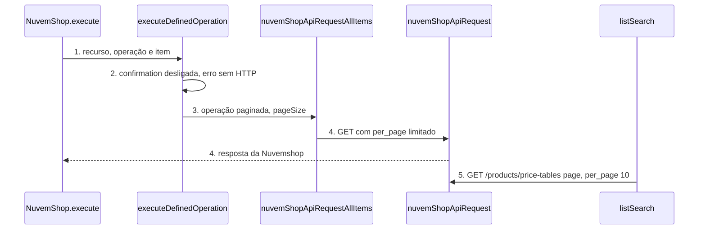

# Nuvem Shop: rotas novas da auditoria de 06/11/2026

**Approved**: 2026-11-06 - user: "implementa as rotas novas de todos"

> Build this with **tlc-implement**. Every criterion becomes a check with a proof; nothing under
> the open questions is settled while building.

## Problem

O pacote `n8n-nodes-nuvemshop` 1.2.0 cobre 198 operações e 44 eventos de webhook. A auditoria de 06/11/2026 contra a doc oficial 2025-03 (`nuvemshop.dev/en-US/api/resources/2025-03`) achou cinco lacunas. Primeiro, `Payment Option > Get Many` chama `GET /payment-options`, uma rota que nenhuma página da doc descreve; a doc só traz `GET /payment_providers/options` (escopo `read_payments`). Hoje a operação provavelmente responde 404. Segundo, o Trigger não recebe 13 eventos que a doc lista: quem monta carrinho abandonado, antifraude, etiqueta, cobrança do app ou troca de tema não consegue assinar o evento. Terceiro, o recurso Price Tables (17 rotas de tabela de preço B2B) não existe no node. Quarto, `DELETE /promotions` e `DELETE /business_rules/integrations/{domain}` não existem; quem quer limpar as promoções ou as integrações do app precisa de `Custom API Call`. Quinto, a criação de pedido não expõe `inventory_behaviour`, e a atualização de ordem de envio não lista o status `IN_PREPARATION`.

Quando isso sair: `Payment Option > Get Many` devolve a lista de provedores, o Trigger assina os 13 eventos novos, o node gerencia Price Tables com tabela e cliente em lista pesquisável, as duas remoções existem com trava de confirmação, e o pedido aceita `inventory_behaviour`. Workflows salvos continuam iguais.

## Shape

Reutiliza `standardCrudOperations`, `pathParameter`, `jsonBody` e `jsonQuery` (`definitions/common.ts`), o Resource Locator por `ID_KINDS` (`helpers/resourceLocator.ts`), o `listSearch` e a lista única de eventos `NUVEMSHOP_WEBHOOK_EVENTS`; as regras que mudam o resultado (caminho, método, trava de confirmação, tamanho de página) ficam em `definitions/*.ts`, `properties.ts` e `execute.ts`, que os testes alcançam pelo `execute` do node.

1. entra o item do workflow -> `NuvemShop.execute` (exists) - lê `resource` e `operation` e chama `executeDefinedOperation`
2. `executeDefinedOperation` (exists) - monta rota, corpo e filtros; nas operações com `confirmation` (door 1) lê o booleano e lança erro antes de qualquer requisição quando está desligado
3. `nuvemShopApiRequestAllItems` (exists) - pagina com `per_page` limitado ao `pageSize` da operação (door 2); sem `pageSize` mantém 200
4. `nuvemShopApiRequest` (exists) - chama a Nuvemshop com `timeout` de 30 s
5. no editor, `listSearch.searchPriceTables` (new) - lê uma página de 10 de `GET /products/price-tables` e devolve `{ results, paginationToken }`
6. o Trigger (exists) - registra e valida os eventos de `NUVEMSHOP_WEBHOOK_EVENTS`, agora com 57 valores

**Changes underneath**

| Front | What changes |
| --- | --- |
| domain | `Payment Option > Get Many` troca o caminho de `/payment-options` para `/payment_providers/options`; o nome e o tipo dos parâmetros não mudam |
| stored data | nothing to migrate: workflows salvos guardam só `resource`, `operation` e parâmetros |
| readers | o dropdown de evento do `Webhook > Create` e do Trigger lê a mesma lista e ganha 13 itens; `Fulfillment Order > Update` ganha a opção `IN_PREPARATION`; `Order > Create` ganha o campo `inventory_behaviour` |

Data: none - o node não guarda dado; ele repassa a requisição para a Nuvemshop e devolve a resposta.

New: nothing - read only.

## Surface

| Route | In | Out | Status | Who |
| --- | --- | --- | --- | --- |
| `GET /payment_providers/options` | nada | array de provedores com `checkout_payment_options` | `200`; `401` e `403` viram `NodeApiError` | app com o escopo `read_payments`; sem ele a API devolve `403` |
| `POST /products/price-tables` | `name`, `default_discount`, opcionais | tabela criada | `201`; `400` com `errors`; `401` sem credencial vira `NodeApiError` | credencial Nuvemshop válida; sem ela `401` |
| `GET /products/price-tables` e `GET /products/price-tables/{id}` | `page`, `per_page` (máximo 10) | tabela ou lista | `200`; `401` | credencial válida; sem ela `401` |
| `PUT /products/price-tables/{id}` | corpo completo da tabela | tabela atualizada | `200`; `400`; `401` sem credencial | credencial válida; sem ela `401` |
| `PUT`, `GET`, `DELETE` em `/products/price-tables/{id}/categories` e `/product-variants` | lista de exceções ou ID | exceção ou lista (máximo 50 por página) | `204` na escrita e na remoção, `200` na leitura; `401` sem credencial | credencial válida; sem ela `401` |
| `PUT /products/price-tables/{id}/customers`, `POST .../approve-customers`, `DELETE .../customers/{id}`, `GET .../customers` e `GET /products/price-tables/customers/{id}` | lista de IDs de cliente (até 10.000) ou ID | lista de clientes ou de tabelas | `204`, `200`, `409` com os clientes em conflito; `401` sem credencial | credencial válida; sem ela `401` |
| `DELETE /promotions` | nada | corpo vazio | `204`; `401` sem credencial | credencial válida do app; sem ela `401` |
| `DELETE /business_rules/integrations/{domain}` | `events` (lista separada por vírgula ou `all`) | corpo vazio | `204`; `401` sem credencial; `403` sem Business Rules habilitado | app com Business Rules habilitado pela Nuvemshop; sem ele `403` |

## Landing

| One-way door | Literal shape | Alternative rejected |
| --- | --- | --- |
| trava de confirmação | campo opcional `confirmation: { name, displayName, description }` em `NuvemShopOperationDefinition`; `properties.ts` gera um booleano com esse `name`, padrão `false`, e `execute.ts` lança `NodeOperationError` antes do HTTP quando está `false` (Jev 0,95) | `if` por caminho em `execute.ts`: cada operação destrutiva futura copiaria o `if` |
| tamanho de página por operação | campo opcional `pageSize` em `NuvemShopOperationDefinition`, repassado a `nuvemShopApiRequestAllItems` como teto de `per_page` | trocar o teto global de 200: quebra as listas que aceitam 200 |
| nomes dos parâmetros novos | `priceTableId`, `categoryId`, `variantId`, `customerId`, `confirmDeleteAllPromotions` e `confirmDeleteIntegration`; `priceTableId` e `customerId` viram Resource Locator na versão 2 com o mesmo `name` (AD-009) | nome livre por operação: obrigaria um mapa por rota |
| versão do pacote | `1.3.0`, com a versão 1 e a versão 2 do node intactas | `2.0.0`: nenhum workflow salvo quebra |

- Nothing else in this change is hard to reverse

## Criteria

### S1: Payment Option aponta para a rota que a doc descreve (P1)

`Payment Option > Get Many` deixa de chamar uma rota inexistente.

**Acceptance Criteria**

1. WHEN o `execute` roda com `resource` `paymentOption` e `operation` `getMany` THEN o sistema SHALL chamar GET na rota /payment_providers/options da base da loja e nunca em /payment-options
2. The descrição da operação SHALL citar o escopo `read_payments`
3. The operação `businessRule.getPaymentOptions` SHALL continuar em `GET /payment_providers/options`, sem mudança

### S2: Trigger e Webhook aceitam os 13 eventos novos (P1)

A pessoa assina os eventos de carrinho, antifraude, etiqueta, cobrança, assinatura, cupom, tema e navegação.

**Acceptance Criteria**

1. The `NUVEMSHOP_WEBHOOK_EVENTS` SHALL conter exatamente estes 13 valores novos: `app_subscription/updated`, `charge/created`, `charge/failed`, `charge/paid`, `checkout/created`, `checkout/updated`, `coupon/deleted`, `fulfillment_order/label_created`, `fulfillment_order/label_deleted`, `navigation/updated`, `order/in_fraud_analysis`, `order/in_preparation`, `theme/updated`
2. The lista SHALL ter 57 eventos, sem repetição e em ordem alfabética
3. WHEN a pessoa abre o dropdown de evento do Trigger THEN o sistema SHALL mostrar os 57 valores
4. WHEN o `execute` roda com `resource` `webhook`, `operation` `create` e `event` `checkout/updated` THEN o sistema SHALL enviar POST em /webhooks com `event` `checkout/updated`
5. The eventos de privacidade `store/redact`, `customers/redact` e `customers/data_request` SHALL continuar na lista e em `PORTAL_ONLY_EVENTS`, sem renomear

### S3: Recurso Price Table com 17 operações (P1)

A pessoa cria e mantém tabelas de preço B2B com tabela e cliente em lista pesquisável.

**Acceptance Criteria**

1. The node SHALL expor o recurso `priceTable` com exatamente estas 17 operações e rotas: `create` POST `/products/price-tables`; `get` GET `/products/price-tables/{priceTableId}`; `getMany` GET `/products/price-tables`; `update` PUT `/products/price-tables/{priceTableId}`; `setCategories` PUT `.../{priceTableId}/categories`; `getCategory` GET `.../categories/{categoryId}`; `getCategories` GET `.../categories`; `deleteCategory` DELETE `.../categories/{categoryId}`; `setVariants` PUT `.../product-variants`; `getVariant` GET `.../product-variants/{variantId}`; `getVariants` GET `.../product-variants`; `deleteVariant` DELETE `.../product-variants/{variantId}`; `addCustomers` PUT `.../customers`; `approveCustomers` POST `.../approve-customers`; `getCustomers` GET `.../customers`; `deleteCustomer` DELETE `.../customers/{customerId}`; `getByCustomer` GET `/products/price-tables/customers/{customerId}`
2. WHEN o `execute` roda `priceTable.create` com `name` `Atacado` e `default_discount` `7.00` THEN o sistema SHALL enviar POST em /products/price-tables com o corpo `{"name":"Atacado","default_discount":"7.00"}`
3. WHEN o `execute` roda `priceTable.addCustomers` com `priceTableId` `{ mode: 'list', value: '1' }` e corpo `["123","456"]` THEN o sistema SHALL enviar PUT em /products/price-tables/1/customers com o array `["123","456"]`
4. WHEN o `execute` roda `priceTable.getMany` com Return All ligado THEN o sistema SHALL pedir `per_page` 10 em toda página
   - `getCategories`, `getVariants` e `getCustomers` pedem `per_page` 50; uma operação sem `pageSize`, como `product.getMany`, continua pedindo 200
5. The parâmetros `priceTableId` e `customerId` SHALL ser `resourceLocator` com modos `list` (padrão) e `id` na versão 2, e texto na versão 1
6. WHEN o editor pede a lista de tabelas sem token THEN o `listSearch.searchPriceTables` SHALL chamar `GET /products/price-tables` com `page` 1 e `per_page` 10 e devolver `{ results }` com `name` `<name> — <id>` e `value` igual ao `id`, mais `paginationToken` `"2"` quando a página veio com 10 itens
7. IF a API responde `409` em `addCustomers` THEN o sistema SHALL lançar `NodeApiError` com o corpo da API, que lista os clientes em conflito
8. WHEN o `execute` roda `priceTable.deleteVariant` com `priceTableId` `5` e `variantId` `136548285` THEN o sistema SHALL enviar DELETE em /products/price-tables/5/product-variants/136548285

### S4: Remoções em massa exigem confirmação (P2)

`DELETE /promotions` e `DELETE /business_rules/integrations/{domain}` só rodam com a confirmação ligada.

**Acceptance Criteria**

1. The operação `discount.deleteAllPromotions` SHALL ser DELETE `/promotions` e a operação `businessRule.deleteIntegration` SHALL ser DELETE `/business_rules/integrations/{domain}`
2. The campo `confirmDeleteAllPromotions` e o campo `confirmDeleteIntegration` SHALL ser booleanos com padrão `false` e descrição que começa com `Warning:`
3. IF a confirmação está desligada THEN o sistema SHALL lançar `NodeOperationError` e não fazer nenhuma requisição
   - desligada → erro, 0 requisições; ligada → 1 requisição DELETE
4. WHEN o `execute` roda `businessRule.deleteIntegration` com `domain` `payments`, `events` `payments/before-filter` e a confirmação ligada THEN o sistema SHALL enviar DELETE em /business_rules/integrations/payments com a query `events=payments/before-filter`
5. IF `events` está vazio em `businessRule.deleteIntegration` THEN o sistema SHALL lançar `NodeOperationError` antes da requisição
6. WHEN o `execute` roda `discount.deleteAllPromotions` com a confirmação ligada THEN o sistema SHALL enviar DELETE em /promotions sem corpo

### S5: Campos novos em rotas já cobertas (P2)

O pedido aceita `inventory_behaviour` e a ordem de envio aceita `IN_PREPARATION`.

**Acceptance Criteria**

1. WHEN a pessoa preenche `inventory_behaviour` com `claim` em `Order > Create` THEN o sistema SHALL enviar `inventory_behaviour` `claim` no corpo do POST /orders
   - o campo é um dropdown com `bypass` (padrão da API) e `claim`
2. The descrição de `Order > Create` SHALL explicar que `claim` valida o estoque por variante somando as linhas e que a API responde `422` com `Not enough stock for variant <id>`
3. WHEN a pessoa escolhe o status `In Preparation` em `Fulfillment Order > Update` THEN o sistema SHALL enviar `status` `IN_PREPARATION` no PATCH da ordem de envio
4. The operações de versão 1 e de versão 2 existentes SHALL manter nome e tipo de todo parâmetro (comparação das propriedades de `origin/main` contra a branch)

## Out of scope

| Excluded | Why |
| --- | --- |
| Rotas só em `unstable` (Custom Objects, Store Media, Invoice, External Invoice) | o dono pediu para não implementar o radar `unstable` |
| Renomear os eventos de privacidade (`store/redact`, `customers/redact`) | a doc usa `app/store_redact` e `customer/redact` em títulos e `Customer redact` na tabela; ela não decide a string que o webhook envia |
| Filtro `shipping_status=in_preparation` em `GET /orders` | `order.md` lista só `any`, `unpacked`, `unfulfilled` e `fulfilled` |
| `aggregates=fulfillment_orders` e `custom_fields` em `GET /orders` | o node já expõe os dois valores |
| Parâmetros `include_removed_variant_ids` e `visibility` em `GET /products` | fora da lista do pedido de hoje; a auditoria os cita como lacuna menor |
| `DELETE /products/price-tables/{id}` | a doc não define essa rota |

## Assumptions

| Assumption | Chosen default | Rationale | Confirmed? |
| --- | --- | --- | --- |
| A lista de tabelas não tem busca no servidor | `searchPriceTables` filtra o nome por "contém" dentro da página de 10 e devolve o token da próxima | a doc de `GET /products/price-tables` aceita só `page` e `per_page` | n |
| O corpo de `setCategories`, `setVariants` e `addCustomers` é um array JSON | campo `Body (JSON)` obrigatório, como as outras rotas com corpo array do node | os exemplos da doc são arrays | y |
| Os eventos de cobrança e assinatura só chegam a apps com billing | a descrição do evento diz isso; o node não valida | a doc afirma que são entregues só ao app referido | n |
| O pedido do dono falou em 16 eventos; a doc confirma 13 | implementar os 13 | contagem direta de `webhook.md` | y |

**Open questions:** none - all resolved or logged above.

## Differences from the source

None - the product matches the source

## Sources

- `https://nuvemshop.dev/en-US/api/resources/2025-03/products/price-tables/price-tables.md` - binding - rotas, corpos e limites de página das Price Tables
- `https://nuvemshop.dev/en-US/api/resources/2025-03/payment-option.md` - binding - rota `GET /payment_providers/options` e escopo `read_payments`
- `https://nuvemshop.dev/en-US/api/resources/2025-03/webhook.md` - binding - lista de eventos
- `https://nuvemshop.dev/en-US/api/resources/2025-03/discounts.md` e `business-rules.md` - binding - os dois DELETE
- `https://nuvemshop.dev/en-US/api/resources/2025-03/order.md` e `fulfillment-order.md` - binding - `inventory_behaviour` e `IN_PREPARATION`
- auditoria `auditoria-nuvemshop.md` de 06/11/2026 - binding - lista das lacunas
